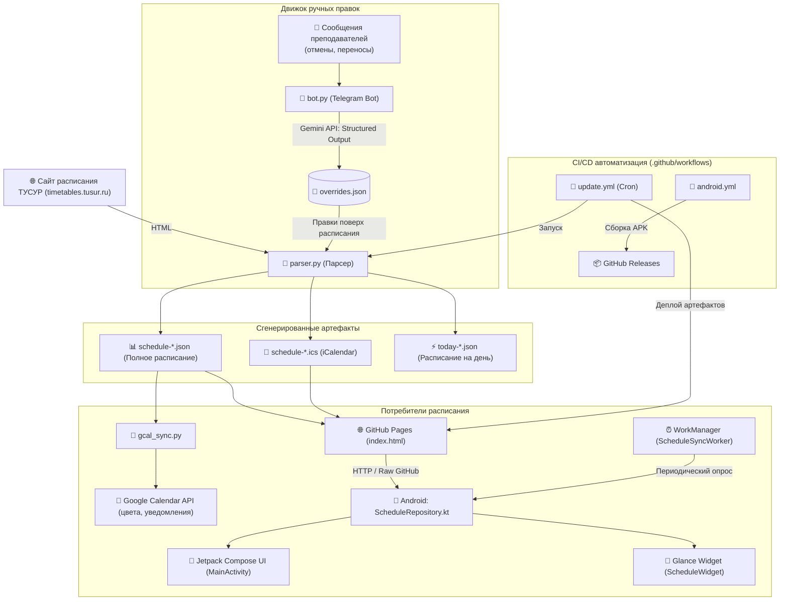

# Архитектура системы tusur-schedule (System Design)

> **Проект**: tusur-schedule  
> **Ведущий архитектор**: `Architect Agent`  
> **Часовой пояс по умолчанию**: `Asia/Tomsk` (UTC+7)  
> **Последнее обновление**: 2026-10-18  

---

## 1. Назначение системы
Автоматический сбор, интеллектуальная корректировка и омниканальная доставка актуального расписания занятий студентов ТУСУР в Google Calendar, веб-интерфейс и нативное Android-приложение с Glance-виджетом рабочего стола.

---

## 2. Диаграмма потоков данных и компонентов

---

## 3. Модули и границы контекстов

| Компонент | Расположение | Стек / Технологии | Зависимости | Зона ответственности |
|:----------|:-------------|:------------------|:------------|:---------------------|
| **Парсер** | `parser.py` | Python 3.11+, BeautifulSoup, requests, icalendar | `overrides.json`, Сайт ТУСУР | Сбор занятий, применение оверрайдов, генерация ICS и JSON |
| **GCal Sync** | `gcal_sync.py` | Google Calendar API, OAuth/Service Account | `schedule.json`, Google Cloud | Синхронизация расписания в Google Calendar с цветовой маркировкой |
| **Telegram Bot** | `bot.py` | python-telegram-bot, Google Gemini API (Structured Outputs) | `overrides.json`, `.env` | Парсинг текстовых сообщений преподавателей через LLM, предпросмотр карточек, запись правок |
| **Android App** | `android/` | Kotlin, Jetpack Compose, Glance Widget, WorkManager | `schedule-*.json` по сети | Мобильное отображение, интерактивный виджет на рабочем столе, автообновление |
| **CI/CD** | `.github/workflows/` | GitHub Actions | Git, Python, Gradle | Периодический парсинг по cron и релизные сборки APK |

### 3.1. Компонентная структура Android-клиента (`android/app/.../`)

Для обеспечения быстродействия AI-агентов монолитные файлы декомпозированы на независимые слои:
* **`data/`**:
  - `ScheduleModels.kt`: модели данных (строго синхронизированы с `schedule.json`).
  - `ScheduleRepository.kt`: сетевой клиент, кэширование в `filesDir`, выбор групп и подгрупп.
  - `AppUpdateManager.kt`: проверка обновлений APK через GitHub Releases.
* **`worker/`**:
  - `ScheduleSyncWorker.kt`: периодический воркер WorkManager для фонового обновления расписания и виджета.
* **`ui/` (Jetpack Compose)**:
  - `MainActivity.kt`: точка входа (`ComponentActivity`), настройка темы и старт воркера.
  - `ScheduleScreen.kt`: верхнеуровневый экран с управлением состоянием и координацией запросов.
  - `components/ScheduleTopBar.kt`: верхняя панель (селектор группы, подгруппы, преподавателей, кнопка обновления).
  - `components/DateStrip.kt`: горизонтальный селектор дней недели.
  - `components/LiveDayBanner.kt`: баннер текущей пары с таймером и прогрессом / статус завершения дня (пиво).
  - `components/LessonCard.kt`: карточка пары с градиентами, аудиторией, бейджем подгруппы и оверрайдами.
  - `components/UpdateDialog.kt`: диалог предложения обновления APK и прогресс скачивания.
* **`widget/` (Jetpack Glance)**:
  - `ScheduleWidget.kt`: GlanceAppWidget и GlanceAppWidgetReceiver.
  - `ScheduleWidgetModels.kt`: внутренние модели состояния виджета (`HeroInfo`, `MergedLessonItem`).
  - `ScheduleWidgetUtils.kt`: чистые функции форматирования и калькуляции (статусы, hero-пара, объединение подгрупп).
  - `components/WidgetHeader.kt`: заголовок виджета (статус, дата, чип группы, кнопка обновления).
  - `components/WidgetHeroCard.kt`: главная карточка идущей пары или отдыха.
  - `components/WidgetDayHeader.kt`: плашка предстоящего дня.
  - `components/WidgetLessonCard.kt`: карточка отдельного занятия.

---

## 4. Контракты данных (Data Contracts)

1. **`overrides.json`**: массив объектов `OverrideItem` (id, date, action: "set"/"cancel", time_start, type, subject, location, keep_original_location, comment).
2. **`schedule-*.json`**: структура `ScheduleResponse` с объектами `DaySchedule` и `LessonItem` (полностью синхронизирована с `android/.../ScheduleModels.kt`). Содержит списки `pe_teachers`, `english_teachers`, `subgroups` и поле `subgroup` у каждого занятия для фильтрации в Android-приложении и Glance-виджете.
3. **`today-*.json`**: легковесный срез расписания на текущие сутки.

---

## 5. Нефункциональные требования (NFR)

* **Время отклика виджета**: виджет обязан рендериться мгновенно из локального кэша `filesDir/schedule_*.json` без блокировки главного потока.
* **Идемпотентность парсера**: повторные прогоны `parser.py` при неизменном входном HTML не должны создавать дубликатов в ICS или ломать UID событий.
* **Безопасность API-ключей**: токены Telegram, Gemini API и ключи Google Calendar строго изолированы в `.env` и переменных GitHub Actions Secrets.
