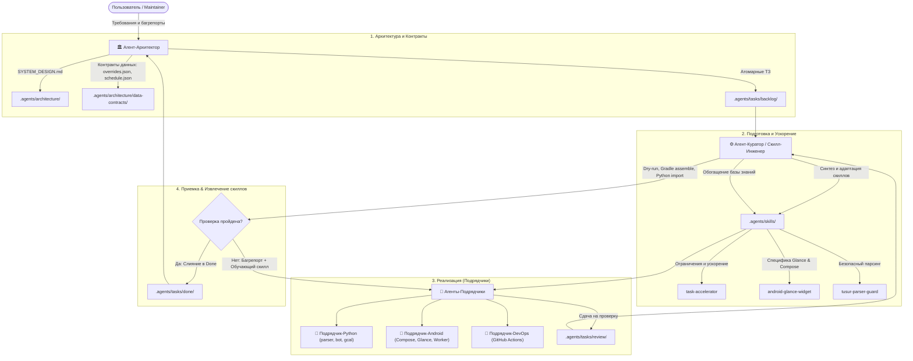

# Multi-Agent Operating System (AGENTS.md)
# Регламент многоагентной разработки для проекта tusur-schedule

Настоящий документ является обязательным исполнительным регламентом для всех агентов Antigravity, работающих в репозитории **tusur-schedule**. Любой агент при старте сессии обязан определить свою роль и строго следовать протоколу.

---

## 1. Архитектурная триада ролей

Проект представляет собой полиглот-монорепозиторий (Python-бэкенд + Android-клиент + CI/CD). Ответственность распределена между тремя ролями:

---

## 2. Ключевые инварианты и правила безопасности

1. **Неприкосновенность контрактов без Архитектора**:
   Форматы файлов `overrides.json`, `schedule.json` и `today.json` связаны напрямую с `ScheduleModels.kt` в Android-приложении и Google Calendar sync (`gcal_sync.py`). Подрядчикам **категорически запрещено** менять имена или типы полей в JSON без предварительного согласования схемы Архитектором в `.agents/architecture/data-contracts/`.

2. **Соблюдение директив `task-accelerator`**:
   * **Никаких `pip install`**: Все зависимости уже установлены в `.venv`. Не запускать установку пакетов, если это явно не запрошено.
   * **Запрет тяжелых сетевых запросов**: Никогда не запускать парсинг всего семестра (`python parser.py --all-weeks`). Тестировать изменения строго локально или на единичной неделе / мок-файле.
   * **Пиннинг файлов**: Перед редактированием определить 1-2 целевых файла. Не делать глобальных поисков по всему репозиторию.

3. **Изоляция технологических доменов**:
   * Задачи по Android выполняются строго внутри каталога `android/`.
   * Задачи по Python-бэкенду (`parser.py`, `bot.py`, `gcal_sync.py`) не должны модифицировать код в `android/`, кроме случаев согласованного обновления моделей данных.

---

## 3. Каталог мета-данных агентов (`.agents/`)

* [`.agents/architecture/SYSTEM_DESIGN.md`](file:///c:/Users/Nikita/Documents/GitHub/tusur-schedule/.agents/architecture/SYSTEM_DESIGN.md) — Полная системная архитектура потоков данных.
* [`.agents/architecture/data-contracts/`](file:///c:/Users/Nikita/Documents/GitHub/tusur-schedule/.agents/architecture/data-contracts/) — Спецификации форматов JSON и моделей Kotlin.
* [`.agents/tasks/TASK_BOARD.md`](file:///c:/Users/Nikita/Documents/GitHub/tusur-schedule/.agents/tasks/TASK_BOARD.md) — Доска задач (Backlog, In Progress, Review, Done).
* [`.agents/skills/`](file:///c:/Users/Nikita/Documents/GitHub/tusur-schedule/.agents/skills/) — База специализированных скиллов Antigravity (Progressive Disclosure).
* [`.agents/personas/`](file:///c:/Users/Nikita/Documents/GitHub/tusur-schedule/.agents/personas/) — Системные профили ролей.
